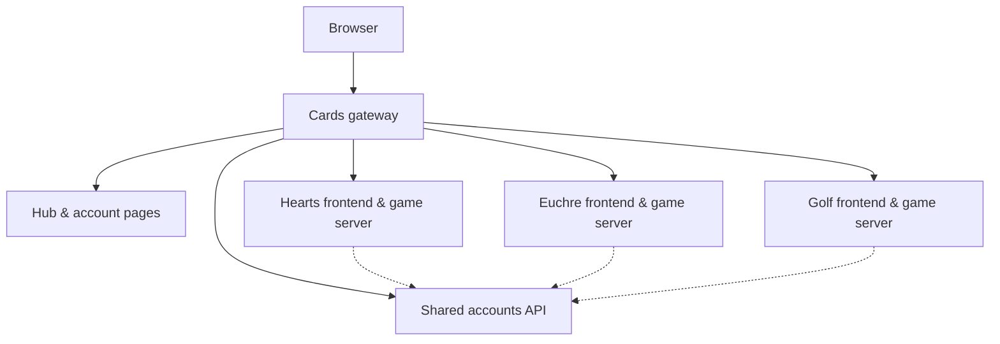

# C A R D S

A shared home for Hearts, Euchre, and Six Card Golf, with one account across
three games, independent game servers, and a responsive hub.

**Live at [cards.shmem.dev](https://cards.shmem.dev/)**

[Play Hearts](https://cards.shmem.dev/hearts/) ·
[Play Euchre](https://cards.shmem.dev/euchre/) ·
[Play Golf](https://cards.shmem.dev/golf/) ·
[Manage your account](https://cards.shmem.dev/user/)

## Features

- **Three games, one home** — jump into Hearts, Euchre, or Golf from the same hub
- **Shared accounts** — sign in once and move between games with the same profile
- **Account management** — registration, email verification, password recovery, profile icons, and account deletion
- **Independent game servers** — each game owns its rules, saves, results, and real-time multiplayer
- **Responsive design** — a mobile-friendly hub with light and dark themes and each game's own visual identity
- **One local command** — start the hub, accounts, and game apps together with isolated development data and a local mail inbox

## Games

- **[Hearts](https://cards.shmem.dev/hearts/)** — the classic four-player game,
  with AI opponents, online lobbies, achievements, and saved games.
  [Project README](https://github.com/shmemcat/hearts#readme).
- **[Euchre](https://cards.shmem.dev/euchre/)** — partnership trick-taking,
  with five AI settings, private lobbies, team names, and leaderboards.
  [Project README](https://github.com/shmemcat/euchre#readme).
- **[Six Card Golf](https://cards.shmem.dev/golf/)** — a nine-hole family variant
  for 2–6 players, with bot opponents, private online rooms, and shared wins.
  [Project README](https://github.com/shmemcat/golf#readme).

The game apps live in their own repositories. This repository contains the hub,
shared accounts service, gateway, and integration tooling.

## Tech Stack

### Frontend

- **HTML, CSS, and JavaScript** — static hub and account pages, with no frontend framework
- **Local fonts and SVG assets** — visual styles shared with the game projects
- **React + TypeScript + Vite** — the game frontends, maintained in their own repositories

### Backend

- **Flask + Gunicorn** — the independent accounts API
- **SQLAlchemy + PostgreSQL** — production account storage; SQLite for the local stack
- **Argon2 + cookie sessions** — password hashing and shared sign-in
- **Alembic** — explicit account-owned schema migrations
- **Private service interfaces** — scoped session validation, public profiles, and game-data cleanup on account deletion

### Infrastructure

- **Node.js** — local gateway, build scripts, and multi-service development runner
- **Docker + Nginx** — container builds, static hosting, API routing, and WebSocket forwarding
- **GitHub Actions + GHCR** — checks and independent, immutable component releases
- **NixOS + Podman** — production services managed in the sibling Infra repository

## Architecture



In production, the gateway serves the hub at `/` and account pages at `/user/`,
with the games under `/hearts/`, `/euchre/`, and `/golf/`. Account requests use
`/api/account/`; game APIs and Socket.IO connections route to their own services.

The accounts service owns identities, sessions, profiles, verification, and
recovery. Game servers validate sessions through its private interface and own
their gameplay data. Account deletion coordinates cleanup across configured
games. Each component can be released and restarted independently.

See the [accounts service](api/README.md) and
[private account contract](docs/account-interface-v1.md) for the service boundary.

## Getting Started

### Prerequisites

- Node.js **22.12+**, Python **3.11**, and **uv**
- Sibling checkouts named `cards`, `hearts`, and `euchre`
- A sibling `golf` checkout to include Golf; the runner detects it automatically
- A Font Awesome Pro package token to install the game frontends' licensed icons

```text
Code/
├── cards/
├── hearts/
├── euchre/
└── golf/       # Optional; enables Golf in the shared runner
```

### Run Locally

From the Cards repository, install the integration dependencies and backend
environments:

```powershell
npm ci --ignore-scripts
uv sync --project api --locked --extra dev
uv sync --project ../hearts/game-api --locked --extra dev
uv sync --project ../euchre/api --locked --extra dev
```

If Golf is checked out, install its backend too:

```powershell
uv sync --project ../golf/api --locked --extra dev
```

In each game repository, copy `.env.example` to `.env`, set
`FONTAWESOME_PACKAGE_TOKEN`, and run `npm run web:install`. Golf can also reuse
the token from Euchre's `.env`. Keep tokens untracked. The hub itself needs no
package-install token.

Start the shared stack from Cards, or run the same command in any game repository:

```powershell
npm run dev
```

Open **[localhost:3000](http://localhost:3000/)**. The runner starts:

- **Cards hub:** `3000`
- **Game frontends:** Hearts `3001`, Euchre `3002`, Golf `3003` when present
- **Backend services:** accounts `5100`, Hearts `5101`, Euchre `5102`, Golf `5103` when present
- **Verification and recovery inbox:** [localhost:3000/__dev/mail/](http://localhost:3000/__dev/mail/)

Run the stack once and use `localhost` consistently so the shared session works
across ports. The local hub redirects game links to their frontend ports.
The runner refuses occupied ports; stop overlapping previews first.
Ctrl+C stops the processes it launched. `npm run dev:split` remains an alias.

### Local Data and Accounts

SQLite databases, stable local keys, and file-only mail stay in the ignored
`cards/.local/split-dev/` directory. Golf has its own `golf.sqlite` there.
Only this isolated stack's migrations run during startup. Existing developer
databases and saves remain in place and are not imported.

The runner strips inherited database and service settings, does not read
production credentials, and sends no provider mail. Local setup does not
migrate live data.

### Other Development Modes

- **`npm run dev:web` in a game repository** starts its frontend preview with separately configured backend destinations.
- **`npm run dev:combined` in Cards** retains the previous hub/combined-API runner for compatibility work. `dev:hub` and `dev:accounts` are also legacy helpers.

See [component releases and local integration](docs/component-releases.md) for
the compatibility and rehearsal workflows.

## Build and Testing

Build and preview the hub and account pages:

```powershell
npm run build
npm run preview
```

The build copies `public/` into `dist/` and versions the hub stylesheet. Game
frontends build separately in their own repositories; this preview does not
start the shared backend stack.

Run Cards' focused checks from the repository root:

```powershell
uv run --directory api --locked --extra dev pytest -q
npm run test:routing
npm run test:release
npm run test:split
```

The split rehearsal uses disposable accounts and databases to check shared
login, Hearts and Euchre frontend proxies, game recovery, account deletion, and
independent service restarts. It verifies that existing developer databases
remain unchanged. Native Nginx routing also runs when `NGINX_BIN` is configured.
Golf's account and online integration checks live in its own repository:
`npm run test:accounts` and `npm run test:online`.

Container rehearsals are opt-in: `test:images`, `test:postgres`,
`test:production-restore`, and `test:cutover`. Follow their runbooks in `docs/`
for prerequisites, access requirements, and data isolation.

## Releases and Production

- **`accounts-vMAJOR.MINOR.PATCH`** publishes the shared accounts API.
- **`gateway-vMAJOR.MINOR.PATCH`** publishes the Cards hub and gateway.
- **`game-vMAJOR.MINOR.PATCH` / `web-vMAJOR.MINOR.PATCH`** in each game repository publish its server / frontend.

Component workflows publish immutable image candidates with source and digest
records. Publishing does not deploy or update `latest`. Routine releases use
the [deploy workflow](skills/deploy/SKILL.md), which tests, publishes, rehearses,
and promotes affected components through the host's release journal once the
required infrastructure capability is activated.

Infra owns production service configuration, credentials, runtime database
roles, and release policy. Containers use immutable image pins, and production
migrations run as explicit jobs rather than during service startup. Operator
procedures live in Infra's `docs/cards-releases.md`, `docs/cards-operations.md`,
and `docs/golf-deployment.md`.

The [legacy publishing workflow](docs/legacy-releases.md) is manual-only,
requires acknowledgement, and refuses existing image versions. The guarded
combined rollback remains available through Infra; the
[original split cutover receipt](release/deployments/split-2026-10-22/README.md)
records the initial ownership handoff.

## Project Layout

```text
api/        Shared accounts service, migrations, and tests
public/     Hub, account pages, themes, fonts, and logos
scripts/    Build, development, integration, and release tooling
deploy/     Gateway image, Nginx routes, and rehearsal configurations
docs/       Service contracts, compatibility notes, and runbooks
release/    Component definitions and historical release receipts
skills/     Application deployment workflow and operator reference
```

## Assets

Game logos and fonts are reused from Hearts, Euchre, and Golf. EB Garamond,
Terminal Dosis, and Fraunces are bundled locally with their SIL Open Font License
notices in `public/assets/fonts/`. Phosphor and Font Awesome notices live in
`public/assets/` and `public/assets/icons/`. Navigation icons are bundled SVGs
from the games' licensed Font Awesome set.
