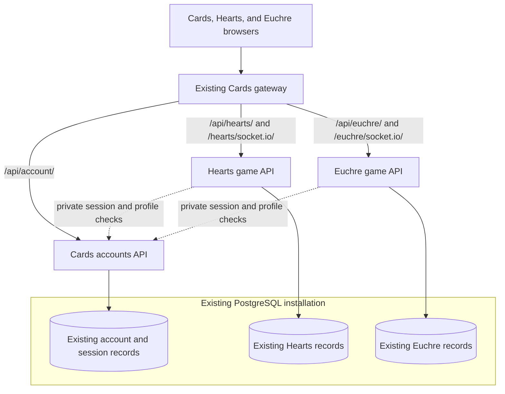

# Separate Hearts and Euchre servers, keep Cards accounts shared

Status: staged implementation plan. Updated 2026-10-22. The first six slices are committed, and the first immutable accounts/Hearts/Euchre/gateway images are published. Native integration, workflow contracts, Compose rendering, container execution, PostgreSQL runtime grants, synthetic migration checks, and published-digest integration are verified. A fresh read-only production dump at revision `019` also passed an isolated restore rehearsal with the published pins, all original-column fingerprints, and recovery of all 31 Hearts saves. The reviewed ownership/routing cutover and a fresh maintenance-boundary backup remain pending. The combined backend remains the deployment default; none of the split services has been activated in the current deployment. See [account interface v1](account-interface-v1.md), [routing compatibility](game-routing-compatibility.md), and [component releases](component-releases.md) for scope and release order.

## Outcome

Run three independently released backend services behind the existing Cards gateway:

- **Cards accounts** owns login, sessions, profiles, verification, recovery, and account deletion.
- **Hearts game server** owns Hearts rules, bots, solo server games, lobbies, multiplayer, results, preferences, achievements, and leaderboards.
- **Euchre game server** owns Euchre rules, bots, lobbies, multiplayer, results, achievements, and leaderboards. Browser-only solo games continue to work as they do today.

Players keep one Cards account and the existing website addresses. An Euchre release must not rebuild or restart Hearts or accounts. A Hearts release must not rebuild or restart Euchre or accounts.

Keep the current PostgreSQL installation and existing records during this work. Separate database servers, a new identity provider, multiple game workers, and a framework rewrite are outside this migration.

## What the code does today

The baseline inspected was Euchre `v1.1.1` (`ddbbc1a`) and Hearts/shared API `v5.0.2` (`a28ebaf`). The following describes that baseline, before the entrypoint refactor.

- `hearts/api/hearts/__init__.py` creates one Flask application and one Socket.IO server for accounts and both games.
- Hearts uses namespaces `/game`, `/lobby`, and `/multi`. Euchre uses `/euchre`. Both clients connect through the HTTP transport path `/socket.io`.
- `hearts/api/hearts/account_sessions.py` validates an opaque cookie against database sessions. Game code calls this implementation directly and imports the shared `User` model.
- Account deletion in `auth_routes.py` directly deletes records belonging to both games. Euchre's persisted JSON table snapshots also contain participant information and need a specific deletion policy.
- `cards/deploy/proxy.conf` sends all `/api/` and `/socket.io/` traffic to `cards-api`.
- Hearts' release workflow publishes the combined API and both Hearts web variants. Euchre currently publishes only its web image.
- Each game keeps live runners and timers in one process, with persisted recovery data. Adding workers is not part of separating the services.
- `hearts/api/entrypoint.sh` runs the shared Alembic migration chain on startup. That cannot simply be copied into three services.

These observations come from local source inspection, rather than a production database inspection.

## Target ownership and routing

Use the existing repositories:

- **Cards:** a new `api/` for accounts; the hub, gateway, local integration runner, and integration tests remain here.
- **Hearts:** `game-api/` provides the independent Hearts server while `api/` retains the combined transition artifact. The default changes only in the later release/cutover phases.
- **Euchre:** a new `api/` receives the Euchre server and its tests from Hearts.
- **Infra:** defines the separate private containers, encrypted environment files, image pins, health checks, and routing activation.

No fourth application repository is required. Games use a versioned internal accounts API instead of importing account implementation code from another repository. Any small client adapter should have contract tests; publishing a shared package is optional, not a prerequisite.

Routing rules:

- Keep `/api/account/` as the public account URL.
- Add `/api/hearts/` and `/api/euchre/` as canonical game API prefixes.
- Preserve existing Hearts API URLs through explicit gateway aliases during the compatibility window.
- Route the existing `/api/account/euchre/` result and leaderboard URLs to the Euchre service as compatibility aliases. This longer prefix must take precedence over the general account route.
- Keep the existing Socket.IO namespace names, but give each game its own transport path: `/hearts/socket.io/` and `/euchre/socket.io/`.
- The gateway may rewrite each game transport path to the backend's `/socket.io/`. Test both polling and WebSocket upgrade, queries, cookies, and trailing slashes.
- Ensure each game's client Manager uses its intended transport path; preserve reuse among Hearts namespaces, without sharing a connection across game servers.

Socket.IO namespaces alone do not give the gateway separate HTTP routes. Its documentation distinguishes the transport `path` from namespaces and describes how Managers can share one connection. See [client options](https://socket.io/docs/v4/client-options/) and [reverse proxy configuration](https://socket.io/docs/v4/reverse-proxy/).

## Shared account contract

Preserve the existing account IDs, password hashes, cookie name and attributes, active session records, CSRF checks, verification links, recovery links, and revocation behavior.

Introduce a versioned, private accounts interface with three responsibilities:

1. **Session validation:** resolve a cookie or supported legacy credential to a verified user or an anonymous guest. Return only the identity and session metadata needed by the game. Distinguish an invalid session from an unavailable accounts service.
2. **Public profiles:** resolve batches of user IDs to names and icons for results and leaderboards. Games must not fetch password hashes, recovery tokens, or email credentials.
3. **Account deletion coordination:** revoke access immediately, request idempotent cleanup from both games, and record durable acknowledgements before declaring deletion complete. Define the pending/failure response and corresponding account UI behavior in the contract milestone. Cleanup must cover active runners, results, snapshots, and concurrent in-flight writes; test retries and service outages.

Only the accounts service creates or revokes account sessions and sends account emails. Game containers receive individual internal-service credentials and limited database roles, rather than the current all-purpose account environment file.

Validate identity at connection/reconnection and before authoritative signed-in socket commands. Preserve the current guest and CSRF rules. Do not add a revocation cache that silently lets logged-out players keep acting. Keep remote authentication calls outside game locks and use bounded timeouts. An accounts outage must produce a retryable service error, not an automatic account downgrade or a service-caused forfeit.

Retain legacy Hearts authentication compatibility for supported older clients through the accounts service; do not copy JWT signing secrets or credential-validation logic into both game servers.

## Data and migration ownership

Separate service processes first; do not move or recreate production tables as part of the initial cutover.

- Accounts owns users, sessions, verification/recovery data, and the deletion coordination records.
- Hearts owns its active games, statistics, difficulty statistics, preferences, results, and game-specific achievements.
- Euchre owns `euchre_tables` and `euchre_game_results`.
- Existing user IDs and foreign-key relationships remain intact. Rework ORM imports and public-profile joins so game runtimes do not depend on an account model containing secrets.
- Replace unrestricted shared database credentials with service-specific table privileges. Explicitly document any temporary compatibility access and remove it before completion.
- Freeze the existing migration history through revision `019` as a reproducible legacy bootstrap. Before branching migration ownership, verify the actual deployed revision and table definitions in the approved rehearsal.
- Give new account, Hearts, and Euchre migrations distinct version tables and ownership. Test both a fresh installation and upgrade of an existing `019` database; never blindly stamp a database or rerun copied table-creation migrations.
- Use a serialized migration job with a migration role. Runtime containers check schema compatibility rather than independently running the old shared `flask db upgrade` at every startup.
- Apply additive schema expansion before promoting images that require it. Pause automatic updates or pin images for migration-bearing cutovers. Do not use image rollback as a database downgrade.

The detailed table/privilege inventory and migration bootstrap are deliverables of the first milestone, before extraction starts.

## Implementation milestones

### 1. Establish contracts and separable entrypoints

Primary repository: Hearts; contract fixtures documented in Cards.

First slice implemented locally: explicit factory roles, app-owned runtime state, injected local account interfaces, a release-derived surface fixture, and regression coverage. The combined entrypoint remains the deployment default. The original first slice left remote transport, distributed deletion, runtime privilege configuration, and migration ownership for phase 3; see the [v1 contract notes](account-interface-v1.md).

- Inventory every public route, socket event, model/table, identity dependency, migration, timer, and legacy authentication path.
- Refactor the global application into factories and injectable account/game adapters. Keep the combined application as the default compatibility entrypoint.
- Remove import-time application coupling, including `from hearts import app` inside service modules. Make background jobs use the correct application context.
- Specify the private session/profile/deletion contracts, their failure behavior, and current-versus-previous version compatibility.
- Add application-registration tests proving that a game-only app does not register the other game's handlers or account mutation routes.

**Exit check:** existing combined behavior passes its regression suite, and isolated app instances have predictable route and namespace inventories. Flask's [application factory pattern](https://flask.palletsprojects.com/en/stable/patterns/appfactories/) supports this refactor without changing frameworks.

### 2. Introduce separate transport paths while the old server still runs

Repositories: Cards, Hearts, Euchre.

Implemented locally: gateway, development, and standalone proxy aliases; updated socket and HTTP clients; supported old-client window and reload message contract; real HTTP/Socket.IO routing checks against the combined backend. Release the gateway compatibility changes before the new clients. See [routing compatibility](game-routing-compatibility.md).

- Add gateway and development proxy aliases for both game transport paths, initially pointing to the current combined backend.
- Update all three Hearts socket clients and the Euchre multiplayer client to use their game-specific path.
- Add the canonical game API prefixes and compatibility aliases without removing existing routes.
- Define a supported old-client window and a clear reload message for clients that cannot use the split services.

**Exit check:** both games work through their new paths against the unchanged backend, and older clients still work through `/socket.io`. This deploys routing compatibility before any server is moved.

### 3. Extract the Cards accounts service

Repositories: Cards and Hearts, with game adapter changes in the relevant packages.

Implemented: standalone account package/image workflow, scoped private v1 transport, opt-in remote adapters, durable deletion with game receipts, account-owned schema migration, public proxy blocking, and pending-cleanup/preference-outage UI behavior. The actual HTTP/Socket.IO rehearsal runs separate local account/game processes and rejects game SQL reads of account tables. Container/PostgreSQL and published-image checks pass with disposable data; actual production-backup restoration and production activation remain separate steps. See [accounts service](accounts-service.md) for configuration, schema preparation, drain requirements, and limits.

- Move accounts, session validation, password security, and mail code into `cards/api/`, preserving behavior and history references.
- Remove account modules' imports of Hearts gameplay models. Implement the agreed profile and deletion contracts.
- Add private session validation and limited internal-service authentication. Keep it inaccessible through the public gateway.
- Update the combined/game applications to use the remote account adapter, including existing Hearts authentication paths.
- Publish an accounts image with its own entrypoint, health/readiness checks, tests, and release workflow.

**Exit check:** one login works across the hub and both games; guest play, logout, reset, email change, expiry, deletion, and accounts-outage tests pass without game access to account secrets.

### 4. Move Euchre into its own server

Repositories: Euchre and Hearts.

Implemented locally: `euchre/api/euchre_server` owns its engine, HTTP/socket handlers, models, runtime state, remote account client, and idempotent deletion callbacks. It has independent locked dependencies, additive schema ownership, a single-worker image, tests, and a build-only CI workflow that needs no sibling checkout. The existing combined copy and deployment/release settings remain in place until cutover. Cards’ `test:euchre-server` rehearses three separate processes, full-game completion, persisted recovery, shared accounts, deletion, and an unchanged Hearts connection. See the [standalone server guide](../../euchre/api/README.md).

- Move `euchre_engine.py`, `euchre_multiplayer.py`, `euchre_routes.py`, Euchre models, and their tests into `euchre/api/` under an independent package.
- Preserve seat credentials, table snapshots, expiry behavior, result deduplication, and browser/server rules parity.
- Build and test the Euchre backend without checking out or importing the Hearts application.
- Keep one game worker initially, with its own timers, locks, database role, logs, and health checks.

**Exit check:** a standalone Euchre server completes real socket-client games and recovers persisted tables with the same private-view and score guarantees as the current server.

### 5. Finish the Hearts-only server

Repository: Hearts.

Implemented locally: `hearts/game-api/hearts_server` registers only Hearts HTTP handlers and `/game`, `/lobby`, `/multi` sockets. Its runtime owns five Hearts models and uses the private Cards account contract, with no account implementation or Euchre imports. It has explicit database configuration, independent locked dependencies, additive `hearts_001` migration ownership, a single-worker image definition, and build-only CI. The new runtime also fixes first-match multiplayer statistics initialization exposed by the full-game rehearsal. The combined `api/` startup, Docker build, legacy migrations, release workflow, Compose files, and gateway destinations remain in place. See the [standalone Hearts guide](../../hearts/game-api/README.md).

Cards `npm run test:hearts-server` (also available as `test:euchre-server`) now starts all three independent services. It exercises complete games, saved solo/multiplayer recovery, restart isolation in both directions, spectator privacy, legacy Hearts credentials, shared login, account outages/revocation, and durable deletion retry with Hearts offline. Test databases are disposable and runtime SQL guards reject reads/writes to other services' records. Container execution, synthetic PostgreSQL restore/grant checks, and published-image integration also pass through the phase-six runner; deployment activation remains a later step.

- Register only Hearts routes and `/game`, `/lobby`, and `/multi` namespaces in the new game entrypoint.
- Replace remaining direct account/session/profile dependencies with the accounts contract.
- Preserve solo games, lobbies, multiplayer recovery, spectator behavior, results, preferences, achievements, and supported legacy clients.
- Keep the combined entrypoint only as a pinned transition/rollback artifact until cutover is complete.

**Exit check:** the Hearts-only backend passes Hearts tests without loading Euchre or owning account endpoints.

### 6. Separate release artifacts and local integration

Repositories: all three applications; reviewed Infra changes prepared separately.

Implemented locally with transition-specific release tags: Cards `accounts-v*` publishes only accounts; Hearts and Euchre `game-v*` publish only their new backend image. Each pipeline tests its own repository, smoke-checks the image, rejects an existing version, and records the digest/source/schema/account contract. Existing `v*` workflows remain unchanged to preserve current deployment behavior. Switching web/backend release defaults is deferred to the reviewed cutover.

Cards now has `dev:split`, an isolated local runner for accounts and both game backends/web apps; a separate PostgreSQL Compose stack with ordered migrations and restricted roles; shared public-contract checks for native and pinned-image runs; digest-only CI requiring no sibling source builds; and a candidate-pin utility that changes one component while preserving the other pins. Node, Vite, native Nginx, all four image builds, real PostgreSQL role/grant execution, and component replacement checks pass locally. `test:postgres` also restores synthetic legacy `019` data into a separate `hearts` schema database, verifies repeated migrations preserve records, and checks readiness using restricted runtime credentials. All four first publishing workflows and the local Cards-only rehearsal of their exact registry digests passed. The separate `gateway-v*` workflow publishes the required gateway candidate without promoting `latest`. [Candidate pins and evidence](../release/rehearsals/split-v1.0.0/README.md) are committed; the manual pinned-image CI workflow can repeat the same check. See [component releases](component-releases.md).

- Cards keeps its existing `v*` gateway release. A separate `accounts-v*` workflow releases only `cards-accounts-api`.
- During the transition, Hearts `game-v*` releases only `hearts-game-api`, with no accounts or Euchre code in the image; its existing `v*` release remains unchanged until cutover.
- Euchre `game-v*` releases only `euchre-game-api`; the existing `v*` web release remains unchanged.
- Use new game-image names during migration. Do not change the meaning of the live `hearts-api:latest` image underneath the current combined deployment.
- Give every component immutable version tags, source revisions, independent pins, and independent promotion/rollback controls. Retain compatibility with the previous released account contract.
- Update Cards' local runner and isolated integration stack to start accounts plus both game services, with separate health checks and development ports.
- Add a shared integration test job that consumes pinned images from the other repositories. Building or publishing one game must not require rebuilding another repository.

**Exit check:** a release rehearsal updates just one game's containers, while a connected client in the other game retains its connection, turn, score, and account session. Accounts-only and gateway-only releases have their own checks.

### 7. Rehearse and cut over one owner at a time

Repository: Infra for production configuration; Cards for the operator runbook and integration checks.

The isolated production-data rehearsal is verified locally: `npm run test:production-restore` streams a read-only production dump into private RAM-backed PostgreSQL, adopts revision `019` with the exact published service images, and verifies all 11 original tables through repeated migrations and cold startup. Existing identity/profile/preferences/scores/history, every restored Hearts solo save, restricted runtime access, independent component replacement, and deletion pass. Expired lobby/session cleanup is counted separately from preservation; valid sessions and all other original records remain unchanged. The production deployment and updater are untouched. See the [report](../release/rehearsals/production-restore-2026-10-22/README.md) and [repeatable runbook](production-restore-rehearsal.md). This does not rehearse a live multiplayer writer handoff or apply the cutover below.

Infra's opt-in split configuration, explicit migration/grant artifacts, and [cutover runbook](../../infra/docs/cards-split-cutover.md) are merged in [Infra PR #43](https://forge.nuttynet/nuttyverse/infra/pulls/43). The default remains disabled. The separate activation/rollback targets, encrypted credentials, immutable frontend pins, and [final rehearsal](cutover-rehearsal.md) are now prepared for activation review. Quiet-boundary rollback of split-created solo saves, preferences/results, completed deletion cleanup, and subsequent split reactivation are verified with the currently deployed combined API digest. Active multiplayer and pending deletions refuse rollback; the rollback unit repeats that read-only gate before startup. The first ownership handoff still requires one quiet maintenance window. A gradual live handoff requires separately implemented and rehearsed legacy ownership/admission gates.

- Add private accounts, Hearts game, and Euchre game containers to the existing Podman network. Give each explicit runtime health checks, encrypted environment references, and image pins.
- Keep the current combined API pinned and available as a rollback target. Prepare gateway routes before changing clients or ownership.
- Rehearse with an isolated PostgreSQL restore, file-only mail, seeded games, mixed old/new clients, and service restarts. Compare account and game record fingerprints.
- During the reviewed cutover, freeze automatic image updates, take and verify a fresh backup, and run required additive migrations once.
- Finish existing multiplayer matches, close all public admission, stop the combined writer, and verify a fresh backup before migrations. Do not start any split owner alongside the current combined image.
- With admission closed, validate accounts first, Euchre second, and Hearts third, preserving cookie/session records. Reopen only after all owners and aliases pass together.
- Switch **all** HTTP and game transport aliases together. The single root `/socket.io` transport cannot be split by namespace; after the quiet boundary it returns an explicit reload requirement. A snapshot-based live multiplayer handoff requires its own successful rehearsal.
- Ensure exactly one runtime owns writes and bot timers for each table/game. Never run an active shadow server against the same live tables.
- Re-enable automatic updates only after component-specific health and isolation checks pass. Remove the combined runtime after the compatibility window and rollback checks are complete.

**Exit check:** a subsequent tagged Euchre backend change demonstrably leaves Hearts and accounts untouched, and the reverse is also true.

Infra changes follow that repository's signed-commit and Forgejo review requirements. Planning this work does not apply those changes or alter production services.

## Required acceptance tests

- A single existing account signs in once and is recognized by Cards, Hearts, and Euchre. IDs, profiles, history, achievements, and password hashes are preserved.
- Guest games remain playable without an account. Cookie, CSRF, Origin, and legacy authentication rejection behavior remain correct.
- Logout, password reset, email change, expiry, and deletion stop further signed-in actions in both games. Service errors are distinguishable from revoked identities.
- Account deletion and retries leave no recoverable participant credentials or account information in active/persisted game state, and cannot race into new account-owned awards.
- Polling, upgrade to WebSocket, reconnect, old/new client combinations, invite URLs, direct page refresh, and transport query forwarding work through the production-shaped gateway.
- Restarting/releasing Euchre does not disconnect a Hearts socket, advance its game, change its scores, or trigger a forfeit. Repeat with the games reversed.
- An accounts restart/outage does not corrupt games or turn transient validation failures into guest impersonation or automatic losses.
- Persisted game recovery produces one authoritative runner per game and records results only once.
- A fresh database and an upgraded existing database reach the expected service-owned revisions without migration races or data replacement.
- Games cannot modify users or sessions, access password/recovery/mail secrets, or impersonate another service through forged public headers.
- Each image reports its component, version, and source revision through a safe health/version response or operator-visible metadata. A green generic health endpoint alone is not proof that a particular release was deployed.

## Rollback

Record the current routing configuration, source revisions, database revision, and container digests before each switch. Change one service at a time and keep the previous account contract supported.

For the initial combined-to-split migration, rollback returns all three owners together after closing admission, draining real multiplayer and completing pending account deletions through the split callbacks. Stop all split writers, run the reviewed rollback checks/ID handoff, and select the explicit combined rollback profile. Retain the candidate gateway/frontends for client protocol compatibility. Do not restore an older database or run the combined server alongside a split owner. Active multiplayer snapshot handoff remains unsupported.

Subsequent independent component releases roll back their individual image pin while keeping the account contract compatible. Leave additive versions, deletion receipts and tombstones in place. If pending cleanup cannot finish, keep maintenance and fix the failing owner forward.

Keep the legacy environment file and image digests available through the rollback window. Retire broad credentials, old route aliases, and combined registration only after the separate services have passed production checks.

## First implementation slice

Start with **milestone 1: route/model inventory, application factories, and account interfaces**, with all deployment routing unchanged. Review that slice before extracting code or publishing any role-changing images.

The two most important demonstrations are then: game-specific transport paths work before extraction, and a real Euchre release leaves a live Hearts game undisturbed.
